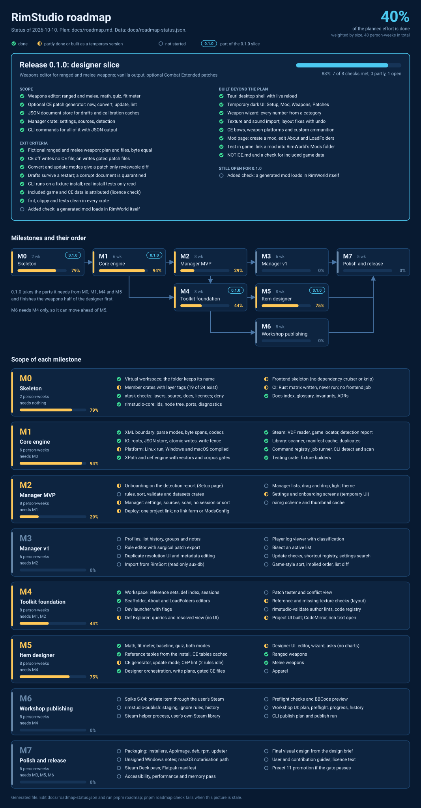

# RimStudio

A cross-platform desktop app for RimWorld modders: a fast mod manager plus a modding toolkit (def explorer, patch tester, item designer for weapons and apparel with optional Combat Extended patches, Steam Workshop publisher). The Rust workspace holds the backend; the frontend is a Preact, TypeScript and Tailwind app. The documentation index is [docs/README.md](docs/README.md).

Status: the 0.1.0 backend slice is built ([status](docs/status/0.1.0-backend.md)); the Tauri desktop shell runs the same UI with native dialogs and the backend in process ([ADR 0043](docs/adr/0043-tauri-desktop-shell.md)). A temporary browser UI, served by Vite and backed by a development bridge, lets you try the designer in a plain browser against your own install.



The picture is drawn from [docs/roadmap-status.json](docs/roadmap-status.json) by `pnpm roadmap` and shows how far each milestone has come; the plan behind it is [docs/roadmap.md](docs/roadmap.md).

## Quick start

Requirements: a Rust toolchain, Node 24 or newer and pnpm 11.

```sh
pnpm install                 # once, and after dependency changes
pnpm dev                     # bridge (cargo) + Vite on http://localhost:5173
```

What `pnpm dev` does:

1. Starts the development bridge, `cargo run -p rimstudio-devserver`, with its own data folder (`$HOME/.local/share/rimstudio-dev`), so it never mixes with the CLI folders. `CARGO_TARGET_DIR` defaults to `$HOME/.cache/rimstudio-target` when unset.
2. Waits for the bridge to write its token file (`node_modules/.cache/rimstudio-bridge.json`, with the port and the token).
3. Starts Vite, which proxies `/rpc` and `/dev` to the bridge and adds the `x-rimstudio-token` header to every request.

Arguments after `--` go to the bridge, for example `pnpm dev -- --data-dir /tmp/rs-dev --port 0`. The bridge finds your game through the usual detection; the environment variables `RIMSTUDIO_GAME_DIR`, `RIMSTUDIO_WORKSHOP_DIR` and `RIMSTUDIO_CE_DIR` point it at a specific install, workshop folder and Combat Extended copy.

### Desktop app

```sh
pnpm tauri:dev               # window with live reload: Vite for the UI, cargo for Rust
```

`pnpm tauri:dev` needs the Tauri system libraries (on Linux WebKitGTK 4.1, libsoup 3 and GTK 3). It starts Vite (hot module reload of the UI), builds the shell and opens the window; an edit under `crates/rimstudio-*` rebuilds and restarts the app. The backend runs inside the app, so no bridge is needed. `RIMSTUDIO_DATA_BASE=/some/folder` puts the app's data folders under one folder, `RIMSTUDIO_DEV_PORT=5390` moves Vite to another port, and `CARGO_TARGET_DIR` defaults to `$HOME/.cache/rimstudio-target-tauri`. `pnpm tauri:build` makes a debug build without bundles, `pnpm tauri:check` runs cargo check and clippy for the shell, and `pnpm tauri:smoke` runs a headless self test (boot, a few commands, exit code 0 or 1; no display needed). Details are in section 18.11 of [docs/architecture/frontend-architecture.md](docs/architecture/frontend-architecture.md).

To debug the desktop app in VS Code, open the folder and press F5: the first launch configuration starts Vite, builds the shell in debug and runs it under gdb (needs the C/C++ extension and `gdb`; stop any other dev server on port 5173 first). The other configurations of `.vscode/launch.json` start `pnpm tauri:dev`, `pnpm dev` or the CLI.

Without the bridge, `pnpm dev:ui` starts only Vite. The app then shows recorded fixtures (the chip in the top bar reads "Mock data") and the component gallery works fully: `pnpm gallery` opens it.

## Notices

RimStudio is independent and is not made, endorsed or supported by Ludeon Studios Inc. or by the Combat Extended team.

Portions of the materials used to create this content/mod are trademarks and/or copyrighted works of Ludeon Studios Inc. All rights reserved by Ludeon. This content/mod is not official and is not endorsed by Ludeon.

Data of RimWorld ([rimworldgame.com](https://rimworldgame.com/)) and of Combat Extended ([official project](https://github.com/CombatExtended-Continued/CombatExtended), used under CC BY-NC-SA 4.0) is included with attribution; [NOTICE.md](NOTICE.md) lists the sources and the included sets.

## Commands

| Command                             | What it does                                                |
| ----------------------------------- | ----------------------------------------------------------- |
| `pnpm dev`                          | Bridge and Vite together                                    |
| `pnpm dev:ui`                       | Vite only (mock data)                                       |
| `pnpm gallery`                      | Vite, opened on the component gallery                       |
| `pnpm typecheck`                    | `tsc` in every package (strict, `noUncheckedIndexedAccess`) |
| `pnpm test`                         | Vitest in every package (happy-dom)                         |
| `pnpm lint`                         | oxlint with the import boundary rules of `.oxlintrc.json`   |
| `pnpm e2e`                          | Playwright (Firefox) against the real bridge and your install |
| `pnpm build`                        | Type check and production build of the desktop app          |
| `pnpm tauri:dev`                    | Desktop window with live reload (Vite and cargo)            |
| `pnpm tauri:build`                  | Debug build of the desktop app, no bundles                  |
| `pnpm tauri:check`                  | cargo check and clippy for `rimstudio-shell`                |
| `pnpm tauri:smoke`                  | Headless self test of the shell                             |
| `pnpm roadmap`                      | Redraws `docs/roadmap.svg` from `docs/roadmap-status.json`  |
| `pnpm roadmap:check`                | Fails when the roadmap picture is stale                     |
| `pnpm format`                       | Prettier over the frontend sources                          |
| `cargo test -p rimstudio-devserver` | The bridge tests (Rust side)                                |
| `cargo run -p xtask -- check-all`   | Layer, source, docs and licence checks (`check-licences` alone: attribution of included data) |

Rust commands set `CARGO_TARGET_DIR` first when your default target folder is small, for example `export CARGO_TARGET_DIR=$HOME/.cache/rimstudio-target`.

## What runs where

| Part              | Folder                       | Notes                                                                                 |
| ----------------- | ---------------------------- | ------------------------------------------------------------------------------------- |
| Backend crates    | `crates/`                    | Business rules, file formats, the command registry (`rimstudio-app`)                  |
| Bridge            | `crates/rimstudio-devserver` | Development only, never packaged; loopback, token and origin checked                  |
| Desktop shell     | `apps/desktop/src-tauri`     | Crate `rimstudio-shell`: Tauri window, native dialogs, the backend in process         |
| Desktop app       | `apps/desktop`               | Vite, Preact; features in `src/features`, shell in `src/app`, IPC in `src/shared/ipc` |
| Component library | `packages/ui`                | `rimstudio-ui`, presentational components and the icon set                            |
| Test kit          | `packages/testkit`           | Mock transport, fixtures, render helpers; never shipped                               |
| Generated types   | `packages/ipc-types`         | Written by the backend bindings test                                                  |

The webview receives JSON only. It has no XML library and no file access; the folder browser in the web build lists folders through the bridge. Details are in the section "As built: the temporary UI" of [docs/architecture/frontend-architecture.md](docs/architecture/frontend-architecture.md).
